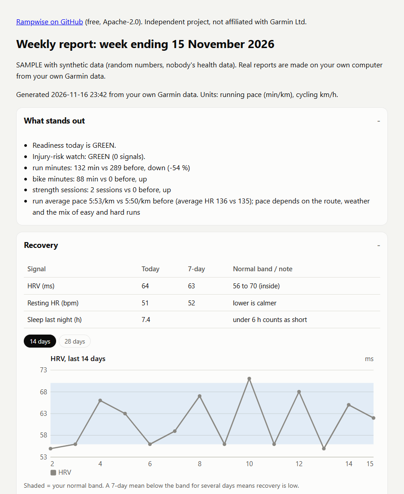

<p align="center"></p>

# Rampwise: an AI coach for triathletes, runners, cyclists and swimmers

**Evidence-labelled coaching for triathlon, duathlon, running, cycling and open-water swimming, for AI agents (Claude Code, Codex, Cursor, Gemini CLI and 25+ other tools).** Race plans for 17 events (no Garmin needed), daily adaptation, an injury-risk watch and daily/weekly/monthly reports built from *your own* Garmin data or a few numbers you type, with specialists for recovery, load, heat, fueling and heart-rate zones. Free and open source (Apache-2.0).

> Independent open-source project. Not affiliated with, endorsed by or sponsored by Garmin Ltd. Garmin is a trademark of Garmin Ltd. and is used here only to say which data the tool reads.

Keywords: Garmin, AI running coach, AI cycling coach, HRV, readiness, training plan, injury prevention, Claude Code plugin, Agent Skills, MCP. Works as a Claude Code plugin, a Codex plugin, a Gemini CLI extension, an Antigravity or Cursor plugin, or as plain Agent Skills in other tools.

> **Status: v0.6.3, experimental.** Built by one runner and cyclist for their own training, then generalised. It has **not** been tested on other people, other watches, or over a full training cycle. There is no promise it works for you. The first user tests it on their own body for three months and will publish an honest update ([docs/FIELD-TEST.md](docs/FIELD-TEST.md)). Read [DISCLAIMER.md](DISCLAIMER.md) first.

[](https://azahir21.github.io/rampwise/sample/)
*A sample weekly report (synthetic data). [Open the interactive sample](https://azahir21.github.io/rampwise/sample/) or visit the [project page](https://azahir21.github.io/rampwise/).*

## Install in a minute

> [!IMPORTANT]
> Rampwise runs **on your computer**: your AI tool must be able to run Python (3.10 or newer). A Garmin account (with the official Personal API) is only needed for *your own* training data; a plan from five numbers needs none.

| Your tool | Install |
|---|---|
| **Claude Code** | `/plugin marketplace add Azahir21/rampwise` then `/plugin install rampwise@rampwise` |
| **Codex** | `codex plugin marketplace add Azahir21/rampwise`, then open `/plugins` and install *rampwise* |
| **30 tools with one installer** (Codex, Gemini CLI, Antigravity, Cursor, GitHub Copilot, Windsurf, Cline, OpenCode, Devin, Kilo Code, Goose, Zed, Amp, Augment, Kiro, Mistral Vibe, GitLab Duo, Qwen Code, Warp, Junie, Factory, Hermes, OpenClaw, Trae, Roo Code, plus an instructions-file fallback for Aider, Continue, Amazon Q and Jules) | `git clone https://github.com/Azahir21/rampwise`, then `python rampwise/install.py --list`, then `python rampwise/install.py --tool codex` (or `cursor`, `zed`, `goose`, several at once: `--tool cursor,zed`; preview with `--tool all --dry-run`) |
| **Vercel skills CLI** (verified: all 11 skills install) | `npx skills add Azahir21/rampwise` |
| **Gemini CLI** | `gemini extensions install https://github.com/Azahir21/rampwise` |
| **Antigravity CLI** | `agy plugin install https://github.com/Azahir21/rampwise` |
| **Cursor** | `python rampwise/install.py --tool cursor` or `npx skills add Azahir21/rampwise` |
| **Hermes Agent** | `hermes skills tap add Azahir21/rampwise` then `hermes skills install Azahir21/rampwise/skills/rampwise` |
| **No git** | download `rampwise-skills.zip` from the [latest release](https://github.com/Azahir21/rampwise/releases/latest), unzip, and run `python install.py --tool claude-code` (or `--tool codex`, `--tool cursor` ...) |

**Then, once:**
1. `pip install fitdecode` (it reads FIT files).
2. For your own Garmin data: install [uv](https://docs.astral.sh/uv/), then `uv tool install --python 3.12 garmin-personal-mcp` and `garmin-personal-mcp auth` (the server is [`garmin-personal-mcp`](https://github.com/Mason-Levyy/garmin-personal-mcp), MIT, by Mason Levy; follow its README for the key).
3. Restart your tool and say: **"Set up my Rampwise coach."** It interviews you (goals, injuries, equipment, schedule) before it plans anything.

Skills appear in Claude Code as `/rampwise:rampwise`, `/rampwise:rampwise-planner` and so on; subagents as `rampwise:coach-recovery`, etc. Details and per-tool notes (cloud-only agents cannot reach your Garmin data): [docs/INSTALL.md](docs/INSTALL.md).

## What it does
- **Race plans for 17 events, with or without Garmin**: 5K to 50 km ultra, sprint to Ironman triathlon, sprint and standard duathlon, gran fondo to 300 km rides, 1.5 to 10 km open-water swims. Base, build, peak and taper, a lighter week every 4th week, +10 % weekly cap, swim/bike/run/strength sessions with brick runs. Give event, date, level, hours and days; it asks for anything missing. See the [example plans](https://azahir21.github.io/rampwise/#plans).
- **Plan viewer and exports**: one interactive HTML page per plan; calendar (.ics), spreadsheet (.csv), Zwift (.zwo) and ERG/MRC ride files. Garmin `.fit` workout files for runs and rides when your heart-rate data are known. Ride files import into Zwift and trainer apps.
- **Plans**: rolling 4-week plans (easy, long, tempo, strides, intervals, climb and MAF-test sessions; rides; strength) from your last weeks of training, with reset and deload weeks and a +10 % step cap.
- **Garmin workouts**: writes structured `.fit` workout files (warm-up, steady, intervals, rest, cool-down) with your watch's own heart-rate **zone** when one covers the band, otherwise a custom bpm range, and says which it used. Not verified on every watch.
- **Specialists**: recovery (HRV, sleep, resting HR to a GREEN/AMBER/RED readiness), aerobic base (pace at a heart rate, drift), load and injury flags plus chronic/acute training load (CTL, ATL, TSB, as context), heat and weather adjustment, fueling and sweat-rate maths, strength placement.
- **Analyse**: your latest session against the last similar one, and the last 7 days against the 7 before (works on any day, activity or not), plus an **injury-risk watch** that combines load, recovery and what you tell it about pain. Flags are prompts with an evidence label, never a diagnosis.
- **Adapt**: each morning it re-checks tomorrow's planned session against your readiness, the watch and how much of the plan you actually did: keep, a small step up (only when everything is green), easier, shorter, or rest. It prepares the calendar update; it changes your calendar only after you agree.
- **Reports**: daily, weekly and monthly reports as Markdown with figures and as an interactive single-file HTML page (offline, light/dark): recovery, week-over-week, injury watch, plan against done, pace/speed and efficiency trends, strength logs and goal meters. Goals are optional and follow your own settings.
- **Strength generator**: 11 goal profiles (endurance, runner 5K to marathon, trail and ultra, middle distance, cyclist road / sprint / bone health, triathlon, sprint, general), a 60-exercise library, progression from your own logged sets.
- **Memory**: goals, injuries, equipment and preferences persist in a file on your computer.
- **Honesty**: every rule is tagged *research*, *practice* or *gap* in an evidence map; the papers are listed in [docs/PAPERS.md](docs/PAPERS.md). It asks instead of assuming (heart-rate data, equipment, starting weights) and falls back to your activity trend only if you do not answer.
- Adaptive by design: quality sessions are on for everyone and locked only by *your* data (an active injury, a RED reset week, your own settings).

## What it sends or fetches
Everything that leaves your computer, in one place (also in [PRIVACY.md](PRIVACY.md)):
- **Garmin:** the scripts talk to the `garmin-personal-mcp` server on your own machine, which reads your account with your own saved key. Nothing about this goes to Rampwise or to anyone else.
- **Open-Meteo (weather):** only if you ask for weather; rounded start coordinates and dates.
- **Europe PMC (papers):** when the coach fetches an open-access paper, only the paper's ID or DOI. The text it receives is treated as data to read, never as instructions.
- **GitHub:** only when you run `install.py --update` (a `git pull`).
- **The AI model you use** sees what the coach prints in a session (numbers from the scripts, a summary of your athlete file), under that provider's terms.
Rampwise has no server and no analytics. Support and issues: [GitHub issues](https://github.com/Azahir21/rampwise/issues).

## Other watch brands and Strava
The aerobic analysis of one activity also works on a `.fit` file from any maker (`analyze_activity.py --fit-file FILE`) and, in early draft, on Strava data saved as JSON (`--strava-json FILE`). Readiness, load and reports are still Garmin-only. Details, what each brand leaves out, and Strava's subscription and terms: [docs/OTHER-WATCHES.md](docs/OTHER-WATCHES.md).

## Updates (auto-update)
- **Claude Code:** third-party marketplaces do **not** auto-update by default. Turn it on: `/plugin` -> *Marketplaces* -> *rampwise* -> *Enable auto-update*. A plugin updates when its `version` changes, and this repository bumps the version on every release. Manual: `claude plugin update rampwise@rampwise`, then `/reload-plugins`.
- **Claude Code, always on:** per Anthropic's docs the marketplace entry in your settings can carry `autoUpdate` (`extraKnownMarketplaces`); check the current docs for the exact shape, and note that updates apply after `/reload-plugins` or the next launch.
- **Codex:** `codex plugin marketplace upgrade rampwise` (the docs do not describe automatic plugin updates).
- **`npx skills` users:** `npx skills update` (a command you run; it compares the stored commit and folder hash and re-installs what changed; no background auto-update found).
- **Hermes users:** `hermes skills check` then `hermes skills update` (also manual; locally edited skills are skipped unless `--force`).
- **install.py users:** `python install.py --update --tool <your tool>` runs `git pull --ff-only` and reinstalls. Remove with `--uninstall`.
- Your personal data is **not** in the plugin folder, so updates never overwrite it.

## First run
Ask your agent: *"Set up my Rampwise coach."* The head coach creates your `athlete.json` (`athlete.py init`), interviews you (goals, injuries and how you feel today, equipment, exercises you cannot do, schedule, and whether you want to share your watch's heart-rate zones), checks the Garmin connection, then builds your first plan. After that: *"How am I today?"*, *"Plan the next two weeks"*, *"Build my workouts"*, *"Why did my heart rate drift?"*.

**A day with it:** morning, *"Daily report"* (readiness, injury watch, yesterday's session against the last similar one, tomorrow adapted) and *"adjust tomorrow"* (updates your `[GC]` calendar event after you agree). Sunday, *"Weekly report"*. First of the month, *"Monthly report"*. Reports land in `~/rampwise-data/reports/` (override with `RAMPWISE_DATA`); `latest-weekly.html` is always the newest.

## FAQ
**What is Rampwise?** A free, open-source set of AI agent skills that coaches a runner or cyclist from their own Garmin data: training plans, daily adaptation of the next session, an injury-risk watch, and daily/weekly/monthly reports.

**Is it free?** Yes (Apache-2.0). You need your own Garmin account with Personal API access and an AI agent client such as Claude Code, which has its own terms and costs.

**Is it affiliated with Garmin?** No. It is independent; Garmin is a trademark of Garmin Ltd.

**Does my data leave my computer?** Your athlete file, plans and reports stay on your machine. The AI model you use sees what the coach prints in a session. Weather lookups are optional and need your consent. See [PRIVACY.md](PRIVACY.md).

**Does it replace a coach or a doctor?** No. It is experimental and not medical advice; injury flags are prompts, not a diagnosis.

**How are its rules chosen?** Each rule is labelled *research*, *practice* or *gap* in an evidence map, and the papers are listed in [docs/PAPERS.md](docs/PAPERS.md).

**Which watches and AI tools work?** Built and used on one person's Garmin data with Claude Code. The installer and manifests cover 30 AI tools, and field reports from other watches and clients are welcome.

## Help it grow
If it helps you, star the repo, tell a training partner, or open an issue with what worked and what did not. Anonymous field reports (no raw health data) are welcome and feed the three-month field test in [docs/FIELD-TEST.md](docs/FIELD-TEST.md). Cite it with [CITATION.cff](CITATION.cff).

## Upgrading from "Garmin Coach" (before v0.3.0)
The project was renamed to Rampwise so it does not use another company's trademark. Skills are now `rampwise-*` and the plugin is `rampwise` (`/plugin marketplace add Azahir21/rampwise`, then `/plugin install rampwise@rampwise`). Your data keeps working: `RAMPWISE_DATA` falls back to the older `GARMIN_COACH_DATA`, and `~/garmin-coach-data` is still used if it is the only folder that exists. Calendar events made earlier (marker `garmin-coach-plan`) are still found. GitHub redirects the old repository address.

## Where files go
Generated files (plans, plan pages, exports, reports, workouts, the dashboard) go to one main folder, **`~/rampwise-coach/`**, with a subfolder for each kind:
```text
rampwise-coach/
  plans/<event>-<date>/    plan.json, plan.html (viewer), exports/ (.ics .csv .zwo .mrc)
  plans/plan-<date>.json   rolling plans built from your Garmin history
  reports/<date>-<mode>/   report.md, figures/, report.html
  workouts/                .fit workout files
  dashboard/               dashboard.html and its history
```
Your **data** (`athlete.json`, your profile, the adapt state) stays in `~/rampwise-data` and is never moved by this setting.
Change the output folder without moving anything: `athlete.py set preferences.output_dir '"~/my-training-files"'`, or set `RAMPWISE_OUT`, or add `--here` to a command to write into a `rampwise-coach` folder in the directory you are working in. Use `"cwd"` as the preference to always do that. Older files stay where they were and are still found.

## Paper library (for the "why?" questions)
The repository lists every paper behind a rule (`docs/PAPERS.md`) but does not ship the texts. Run `python tools/build_paper_files.py` once: it saves the full text of open-access papers and the abstract (with citation) of the others into each skill's `references/papers/` folder, with an `INDEX.md` that says which is which. The coach opens the file before quoting a paper, and says "abstract only" when that is all there is. Details: [docs/EVIDENCE-DEPTH.md](docs/EVIDENCE-DEPTH.md).

## Safety and evidence
Not medical advice. See [DISCLAIMER.md](DISCLAIMER.md). The planner never promises a date for a goal; targets are checked against your data. See [PRIVACY.md](PRIVACY.md) for what stays on your machine.

## Repository layout
```text
.claude-plugin/        Claude Code plugin and marketplace manifests
plugin.json            portable manifest (Codex)
.agents/plugins/       Codex marketplace catalogue
.mcp.json              the Garmin data server
skills/                eleven Agent Skills (SKILL.md + scripts + references)
agents/                nine subagent prompts (Claude Code)
tools/                 install, owner placeholders, paper fetcher
tests/                 repo checks and offline tests (no Garmin account needed)
docs/races/            example plans for the 17 events (tools/make_demo_plans.py)
docs/index.html        project page (SEO, FAQ, structured data); docs/sample/ is the sample report (tools/make_sample_report.py, synthetic data)
docs/                  papers, field-test protocol, harness notes
```

## Contributing
Issues and pull requests are welcome, especially: users on other watches, new goal profiles backed by papers, translations, and new report sections. See [CONTRIBUTING.md](CONTRIBUTING.md). Credits and licences: [CREDITS.md](CREDITS.md). Licence: [Apache-2.0](LICENSE) (code, docs and evidence maps); third-party code keeps its own licence, see [NOTICE](NOTICE) and [CREDITS.md](CREDITS.md).
